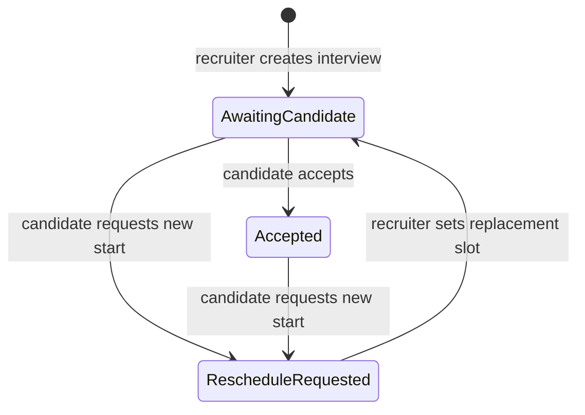

# Schema

Status: `app_user` and `interview` are mapped by the JPA entities in `com.interviewscheduling.domain`. Hibernate creates and updates the tables (`ddl-auto=update`) in the local H2 file database (`./data/interview-scheduling`).

Names are snake_case. `user` is reserved in H2, so the people table is `app_user`.

On startup, if no user has role `ADMIN`, `AdminSeedConfiguration` inserts one. The email and password come from `app.admin.email` and `app.admin.password`. The password is stored as a BCrypt hash. The local defaults are `admin@localhost` and `change-me`.

## app_user

| Column | Type | Notes |
| --- | --- | --- |
| id | bigint, PK | Generated |
| name | varchar, required | Display name |
| email | varchar, required, unique | Login identifier |
| password_hash | varchar, required | BCrypt hash. Never store plain text |
| role | varchar, required | `ADMIN`, `RECRUITER`, `CANDIDATE`, or `INTERVIEWER`. One role per user |
| created_at | timestamp (UTC), required | Set on insert |

Only an admin creates or updates rows here.

## interview

| Column | Type | Notes |
| --- | --- | --- |
| id | bigint, PK | Generated |
| recruiter_id | bigint, FK to `app_user.id`, required | Must have role `RECRUITER`. Set once, when the interview is created |
| candidate_id | bigint, FK to `app_user.id`, required | Must have role `CANDIDATE` |
| interviewer_id | bigint, FK to `app_user.id`, required | Must have role `INTERVIEWER`. A confirmed replacement may change it to another interviewer from the recruiter's pool |
| duration_minutes | integer, required | Set by the recruiter. Does not change during a reschedule |
| starts_at | timestamp (UTC), required | Official slot start. Holds the date and the time. The interview's date is the UTC date of this value |
| ends_at | timestamp (UTC), required | Always `starts_at + duration_minutes`. Written only by the service |
| requested_starts_at | timestamp (UTC), nullable | Set only while a reschedule request is open. Holds the candidate's suggested start |
| status | varchar, required | `AWAITING_CANDIDATE`, `ACCEPTED`, or `RESCHEDULE_REQUESTED` |
| created_at | timestamp (UTC), required | Set on insert |
| updated_at | timestamp (UTC), required | Set on every change |

Role checks are enforced in the service layer. The database does not check them.

### Status transitions

When a replacement is set:

- `starts_at` and `ends_at` change, and `interviewer_id` changes if the chosen option uses another interviewer.
- `duration_minutes` stays the same.
- `requested_starts_at` becomes null.
- `status` becomes `AWAITING_CANDIDATE`.

### Slot rules

Enforced by the service on create, on a candidate's requested start, and on a recruiter's replacement slot:

- `ends_at = starts_at + duration_minutes`.
- The UTC date of `starts_at` is Monday through Friday, and `ends_at` falls on that same UTC date.
- `starts_at >= 09:00 UTC` and `ends_at <= 17:00 UTC`.
- For a new or replacement slot, `starts_at` is after the current time. Matching only proposes starts on the 15-minute grid.
- Intervals are half-open, `[starts_at, ends_at)`. A slot may start at the moment another ends.

Overlap check for a new official slot (create or replacement). Two interviews overlap when `existing.starts_at < new.ends_at AND new.starts_at < existing.ends_at`. Check against other interviews where:

- `interviewer_id` matches, or `candidate_id` matches, and
- `status` is `AWAITING_CANDIDATE`, `ACCEPTED`, or `RESCHEDULE_REQUESTED`, and
- the row is not the one being changed.

While status is `RESCHEDULE_REQUESTED`, the official `[starts_at, ends_at)` stays occupied. It changes only when the recruiter saves a replacement. The candidate's requested start is checked against the weekday and time rules only. It does not reserve a second range.

### Common free time query

For one candidate or interviewer and one UTC date, the repository returns the blocking rows (status in the three booked statuses, and `starts_at < dayEnd AND ends_at > dayStart`, where `dayStart` and `dayEnd` are that date at 00:00 and 24:00 UTC). The service subtracts their intervals from `[09:00, 17:00)` on that date. The gaps are computed in memory and never stored.

For a pair of people, run the query for both and take the gaps where both are free. A new slot must fit entirely inside one such gap.

The replacement check excludes the interview being changed, so its current slot does not block its own replacement.

### Matching range query

Matching loads busy time for many people over a date range at once, not one date at a time. It runs one query for the candidates and one for the pool interviewers:

- `candidate_id IN (...)` or `interviewer_id IN (...)`,
- `status` in the three blocking statuses,
- `starts_at < rangeEnd AND ends_at > rangeStart`, where the range is `fromDate` 00:00 UTC to the day after `toDate`, 00:00 UTC.

Gaps, rankings, and in-run reservations are computed in memory. A proposal is never stored.

### Confirm transaction

Confirming a proposal locks all involved `app_user` rows, meaning every candidate and every chosen interviewer in the batch, in ascending id order. It then rechecks every slot and saves all of them or none.

The service runs the overlap check and the write in one transaction, after locking the involved `app_user` rows, ordered by id. Two requests can otherwise both see a free slot and both commit. A unique index cannot express "these ranges must not overlap." H2 has no exclusion constraints, so the database cannot enforce the range rule on its own. A later move to PostgreSQL could add a GiST exclusion constraint on `(interviewer_id, [starts_at, ends_at))` and the same for `candidate_id`.

### Indexes

These speed up reads. They do not enforce uniqueness or non-overlap. They are declared on the `Interview` entity.

- `(interviewer_id, starts_at)`: interviewer calendar, the common free time query, and the overlap query's `starts_at < new end` range for one interviewer. Index name: `idx_interview_interviewer_starts`
- `(candidate_id, starts_at)`: candidate dashboard, and the same range for one candidate. Index name: `idx_interview_candidate_starts`
- `(status)`: admin listing and filters, if needed later. Index name: `idx_interview_status`

A dashboard query is `person_id = ? AND starts_at >= ? ORDER BY starts_at`. The index finds that person, then walks start times in order. The overlap query uses the same index to ignore rows that start at or after the new slot's end, then checks `ends_at` on what remains.

## Not in the schema yet

- Cancellation. There is no `CANCELLED` status yet.
- Availability for interviewers or candidates. Everyone is free in the working window unless booked.
- Stored proposals or temporary holds. Proposals are computed and rechecked on confirm.
- More than one interviewer per interview. That would need a join table.
- Per-user timezone.
- Audit history of reschedule requests. Only the current open request is stored.